<div align="center">

<a href="#play-it"></a>

<br><br>

[](../../releases/latest)
&nbsp;
[](https://modretro.com)
&nbsp;
[](#play-it)

`#chromatic` `#modretro`

</div>

<br>

<div align="center">

## Grandpa left you the farm.

It's overgrown. The barn has caved in. The shack's roof leaks.<br>
But the land is good, and there's a whole valley of it out there.

**Clear it. Plant it. Build it your way. Then build up the town.**

</div>

<br>

<div align="center">

## Watch it grow.

One farm, played from the first morning to its first fall.


<br><br>

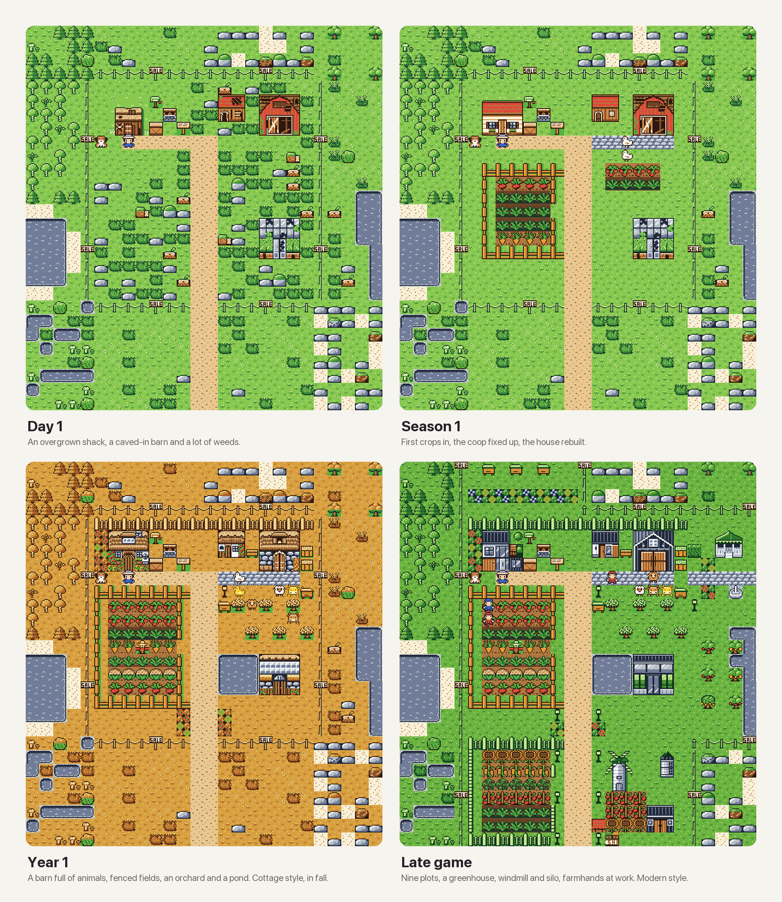

</div>

<br>

<table>
<tr>
<td width="50%" valign="middle">

### Plant something legendary.
Fourteen crops across four seasons, and fruit trees that last forever. Seed packets come in
**Common**, **Rare** and **Legendary**: rare crops double the harvest, legendary ones twinkle in the
field and come up three or four at a time, always gold star. Till, water, sow, sleep, wake up to sprouts.

</td>
<td width="50%"></td>
</tr>
<tr>
<td width="50%">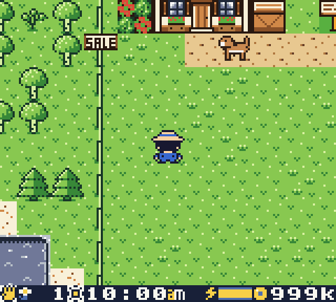</td>
<td width="50%" valign="middle">

### Build it your way.
Barns, coops, greenhouses, silos, sheds, stables, windmills, farm stands and gazebos go wherever you
want them, each previewed as a ghost first. Fences, paths, hedges, flower beds, lamps and string lights,
ponds and bridges. Pick anything up and move it later.

</td>
</tr>
<tr>
<td width="50%" valign="middle">

### Design tools that feel like drawing.
Hold **A** and walk to lay a whole path or fence line in one stroke. **SELECT** swaps to the eraser,
and the build-mode quick menu has **UNDO** for anything you regret. Recolour every roof, plank and
stone on the farm from a swatch page, live. Copy a corner you love into a **blueprint** and stamp it
down anywhere, ghost first.

</td>
<td width="50%">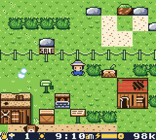</td>
</tr>
<tr>
<td width="50%">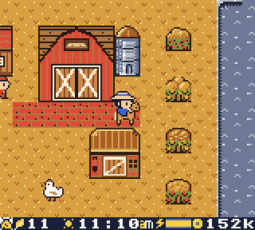</td>
<td width="50%" valign="middle">

### A whole valley, 64 by 64.
Your farm is the middle of a big valley of woods, lakes, marsh, quarries and a river, split into 64
plots. Walk up to a rope line and read the sign, or open the new **valley map**, which shows every plot
by what grows on it, slide the bracket over the one you want and buy it right there.

</td>
</tr>
<tr>
<td width="50%" valign="middle">

### Raise a golden herd.
Cows, hens and sheep, each with a name. Rare Jersey cows, brown hens and cocoa sheep give double, and
golden breeds give double gold-star milk, eggs and wool. Shear right in the field. Two happy adults may
have a baby overnight, and sometimes it comes out one breed better.

</td>
<td width="50%">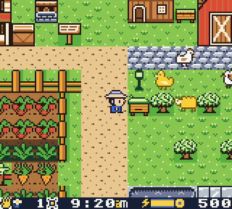</td>
</tr>
<tr>
<td width="50%">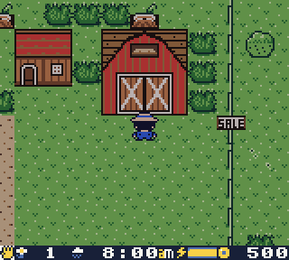</td>
<td width="50%" valign="middle">

### Walk into the barn.
Barns and coops have insides now. On rainy days and at night everyone is in their stall. Milk and
shear by hand, check each animal's panel, fork hay into the mangers, and collect eggs from the nest
boxes. Every building style has its own walls and floor.

</td>
</tr>
<tr>
<td width="50%" valign="middle">

### Saddle up.
Build a stable and Alyssa will sell you a horse: white, chestnut or palomino. Name it, brush it every
day and it grows fond of you. Climb on and the farm goes by at twice walking speed.

</td>
<td width="50%">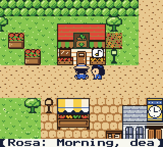</td>
</tr>
<tr>
<td width="50%">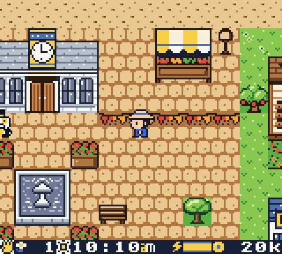</td>
<td width="50%" valign="middle">

### Hire some help.
Mayor Joe knows folks in town who want work. Hire a Waterer, a Harvester, a Rancher and a
Groundskeeper. They show up on your farm by day and do their jobs overnight. Wages grow with the farm.

</td>
</tr>
<tr>
<td width="50%" valign="middle">

### Open a business in town.
Follow the road south to a little town of shops and neighbours. Buy a boarded-up storefront and open a
**Bakery**, a **Juice Bar**, a **Creamery** or a **Florist**. Stock the pantry with what you grow and
it sells every night.

</td>
<td width="50%">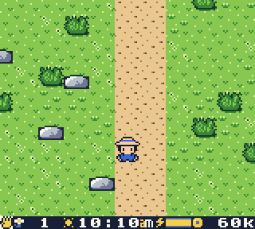</td>
</tr>
<tr>
<td width="50%">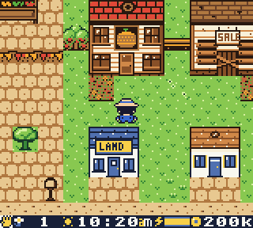</td>
<td width="50%" valign="middle">

### Grow the town.
Give every storefront a new look in four styles and three facade tiers. Open **Market Street** south
of the park and build a **Brewery**, **Winery**, **Restaurant** or **Inn** on its lots, each with a
manager and a pantry. Fund community projects (paving, a playground, a boardwalk, a bandstand, a
community garden, a library) and watch Town Prosperity climb.

</td>
</tr>
<tr>
<td width="50%" valign="middle">

### A town with a life of its own.
Alyssa, Brick, Andy, Raza, Mayor Joe and Marcy keep their own hours: open up shop, meet for lunch on the
cafe terrace, head to the bandstand in the evening. They wave as you pass, and as friendships grow
they come find you for heart events, little scenes you remember. From 4pm, Corey opens the Thirsty Scarecrow by the park: root beer, pie or stew when the cafe has closed.

Every business has a name over the door: Seeds & Needs (Alyssa's general store), The Grumpy Anvil (the forge),
Knock on Wood (Andy's carpentry), Bean There (Raza's cafe), Lots & Plots (Joe's land office), and the ones you
open yourself: Rise & Pie, Main Squeeze, Udder Delight, Petal Pushers, Hoppy Days, Grape Escape, Thyme & Again
and the Snooze Inn.

</td>
<td width="50%">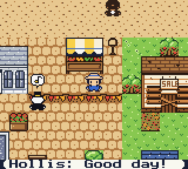</td>
</tr>
<tr>
<td width="50%">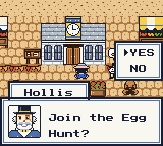</td>
<td width="50%" valign="middle">

### A festival every season.
The **Flower Show** egg hunt in spring, the **Koi Derby** at the fountain in summer, **Giant Produce**
judging in fall and the **Star Night** snowball fight in winter. Each is its own little minigame,
with ribbons for the goods log.

</td>
</tr>
<tr>
<td width="50%" valign="middle">

### Restore the valley.
The town hall board lists six projects: the Town Garden, the Old Orchard, Clear Streams, Town Lamps,
the Market Pantry and the Town Fountain. Donate what you grow, fish and dig, and each one changes the
town for good. Finish all six for the finale.

</td>
<td width="50%">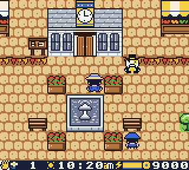</td>
</tr>
<tr>
<td width="50%">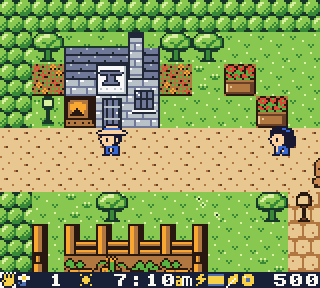</td>
<td width="50%" valign="middle">

### Go down the mine.
West of town, the old Stilwell mine goes twenty floors deep. Hammer rocks for stone, coal and ore,
hunt for the ladder down, and dig up amethyst, topaz, emerald, ruby and diamond. The lift remembers
how far you've been.

</td>
</tr>
<tr>
<td width="50%" valign="middle">

### Spend a morning at the beach.
East of town the sand washes up something new every morning: shells, driftwood and more.
Walk out on the pier and cast into the ocean, where the sea has fish of its own.

</td>
<td width="50%">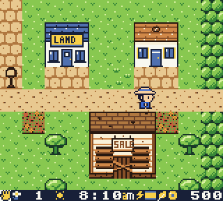</td>
</tr>
<tr>
<td width="50%">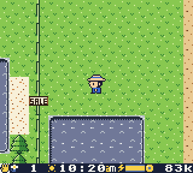</td>
<td width="50%" valign="middle">

### Go fishing.
Cast into any water, wait for the bite and reel it in. What bites depends on the water, the season and
the time of day.

</td>
</tr>
<tr>
<td width="50%" valign="middle">

### Cook something good.
Grandpa left recipe cards taped inside the fridge, and there are sixteen dishes to find. Cook at the
kitchen, then eat for energy and a buff: **Brisk** dishes have you walking at a run.

</td>
<td width="50%">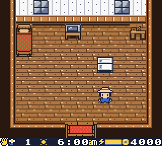</td>
</tr>
<tr>
<td width="50%">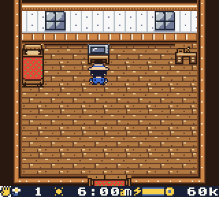</td>
<td width="50%" valign="middle">

### Make the house a home.
Buy furniture from the catalogue and arrange it however you like: rugs, armchairs, plants,
bookshelves, lamps, a fridge, a fireplace, paintings. Upgrade to the Big House and it all comes with
you. The TV has tomorrow's forecast, and the diary saves your game.

</td>
</tr>
<tr>
<td width="50%" valign="middle">

### Four seasons, and the nights between.
Spring greens, golden autumns, snowy winters, rain and thunderstorms. Evenings warm up and get dark,
and your lamps and string lights come on at 7pm.

</td>
<td width="50%"></td>
</tr>
</table>

<br>

<div align="center">

## Make it yours.

Renovate your house and every farm building into one of four styles.


**Classic** · **Modern** · **Log Cabin** · **Storybook Cottage**

</div>

<br>

<div align="center">

## The people of the valley.


</div>

<br>

<div align="center">

## Everything in the box.

</div>

| | |
|---|---|
| **World** | A 64×64-tile valley of woods, lakes, marsh, quarries and a river in 64 buyable plots, a valley map, a town, a mine and a beach |
| **Places to visit** | The Old Woods off Main Street; the Granite Quarry, the High Pasture and the weekend Crossroads Market by minecart; Shell Island by rowing boat. Each has something new every morning |
| **The wider country** | Six regions by stagecoach: Amberwood, Saltmarsh Harbour, Lakeshore, Sunbake Mesa, Pinecrest and Stonegate, each with its own scenery, keeper, music and daily finds |
| **Trade** | A trading post in all eleven places, each paying its own price for every kind of good. Prices move with what you sell, the news and fair days. Earn standing, run carrier jobs, mend each region's landmark, open offices, fill the Almanac |
| **Farming** | 14 crops in Common, Rare and Legendary, 4 fruit trees, quality stars, fertilizer, sprinklers, giant pumpkins |
| **Animals** | Cows, hens, sheep, goats, ducks and pigs, up to 36 of them, in four breeds. Each has a size and a temperament, and one birth in 64 sparkles. Pair them to breed, raise the babies well and they grow up big, sell the ones you don't keep, and fill the Herd Book. Plus a horse to ride and Buddy the dog |
| **Year 3 and on** | An endless Town Fund, seasonal contracts that grow each year, Grandpa's review every spring, the Library's 73-piece collection, a daily surprise, letters and yearly wishes from friends, a fifth heart |
| **Building** | 9 farm buildings, 30+ decorations, 4 fence and 4 path styles, ponds and bridges, move and remove |
| **Design tools** | Paint lines by walking, an eraser, undo, farm-wide colour swatches, and blueprints you copy and stamp |
| **Styles** | Classic, Modern, Log Cabin and Storybook Cottage, for the house, every farm building and every storefront |
| **Farmhands** | Waterer, Harvester, Rancher and Groundskeeper, hired at town hall and paid nightly |
| **Businesses** | Bakery, Juice Bar, Creamery and Florist on the square; Brewery, Winery, Restaurant and Inn on Market Street |
| **Town** | 6 townsfolk with daily routines, portraits, friendship, gifts and heart events; community projects and Town Prosperity |
| **Festivals** | An egg hunt, a koi derby, giant produce judging and a snowball fight, one each season |
| **Restoration** | Six Valley Restoration projects that change the town, and a finale |
| **Mine & beach** | A 20-floor mine with ore, gems and a lift; a beach to forage and an ocean to fish |
| **Cooking** | 16 dishes from Grandpa's recipe cards, with energy and buffs |
| **Home** | A house interior with furniture to buy and arrange, a TV forecast and a diary save |
| **Crafting** | Kegs, cheese presses and preserve jars; ore for copper, iron and gold tools |
| **Fishing** | Ponds, rivers, the fountain and the ocean, with fish that depend on the water, season and time of day |
| **Goals** | Milestones with letters from Grandpa, a year-end review and a collection log |
| **Sound** | Original chiptune songs and jingles on a custom 4-channel driver, plus sound effects |
| **Saves** | One battery-backed save (fits a 32 KB ModRetro cartridge), with an autosave every morning |

<br>

<div align="center">


</div>

<br>

<table>
<tr>
<td width="44%" align="center"></td>
<td width="56%" valign="middle">

## Play it.

**On a ModRetro Chromatic (Codex Edition)**
1. Do ModRetro's one-time setup: update the firmware and enable Developer Mode.
2. Download `stilwell_farms.gbc` from the [latest release](../../releases/latest).
3. In the ChatGPT desktop app, open Codex, invoke the **ModRetro Chromatic** plugin, preview the ROM,
   and choose **Install on Chromatic**. This overwrites the cartridge's current game and saves.

**On any other Chromatic or a Game Boy Color:** write the ROM to a flash cartridge
(MBC5 + RAM + battery).

**On your computer:** open the ROM in any Game Boy Color emulator, such as SameBoy or mGBA.

[](../../releases/latest)

</td>
</tr>
</table>

<br>

## Controls

| Button | On the farm | In build mode | In menus |
|---|---|---|---|
| D-pad | Walk (tap to turn) | Move | Move the cursor |
| **A** | Use your tool, talk, harvest, pet, shear, pick up; on your horse: ride or climb down | Place; hold and walk to paint a line | Confirm |
| **B** | Hold to run; climb off your horse | Leave build mode | Back |
| **SELECT** | Switch tools | Swap to the eraser and back | |
| **START** | Menu: Tools, Seeds, Bag, Build, Farm (status, map, calendar, friends, goods, staff), Options, Save | Quick menu: Undo, Items, Eraser, Colours, Main menu, Done | |

The status bar shows your tool, the season and day, the weather, the clock, your energy and your gold.

<br>

## Under the hood

Stilwell Farms is written in C with [GBDK-2020](https://github.com/gbdk-2020/gbdk-2020) and runs on
real Game Boy Color hardware.

- **Tile cache.** The Game Boy Color can only show 512 background tiles at once. The game keeps all of
  its art on the cartridge and streams just the tiles on screen into video memory as you scroll,
  reference-counting each one. That's what lets one game hold hundreds of buildings, crops and decorations.
- **A valley in battery RAM.** The 64×64 world (every cell's ground, crop and decoration) lives in the
  cartridge's battery-backed RAM, so the whole valley is saved exactly as you left it.
- **Text art pipeline.** Every tile, sprite and map is a text file in `art/`, compiled by
  `tools/gen_art.py` into banked C data. Maps (`art/maps/*.map`) are plain-text grids.
- **Music.** Songs are written in a small MML dialect (`art/music/*.mml`) and compiled by
  `tools/gen_music.py` for a custom VBlank-driven driver.
- **Headless playtesting.** `tools/play.py` and `tools/test_suite.py` drive the ROM in PyBoy from
  scripts, with pathfinding, memory inspection and screenshots.

### Build from source
```sh
# needs GBDK-2020 (https://github.com/gbdk-2020/gbdk-2020/releases) and Python 3
python3 -m venv .venv && .venv/bin/pip install pillow pyboy
GBDK=/path/to/gbdk ./build.sh        # -> build/stilwell_farms.gbc
```

<br>

<div align="center">

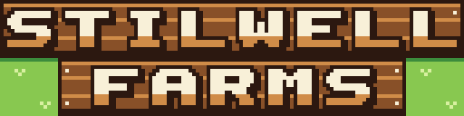

<sub>Stilwell Farms is an independent, original fan project made for the ModRetro Chromatic. It is not
affiliated with or endorsed by ModRetro, OpenAI or Nintendo. Game Boy and Game Boy Color are
trademarks of Nintendo.</sub>

<br>

`#chromatic` `#modretro` `#gameboycolor` `#homebrew` `#gbdk` `#pixelart` `#chiptune` `#farminggame`

</div>
