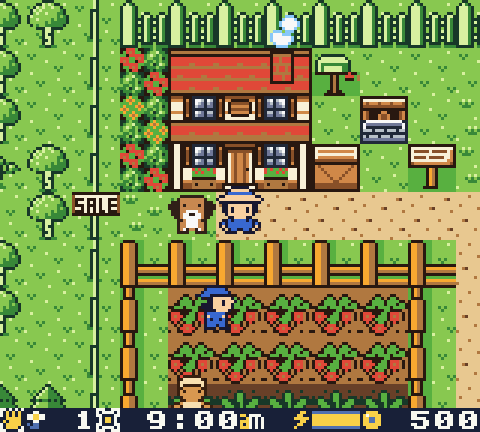
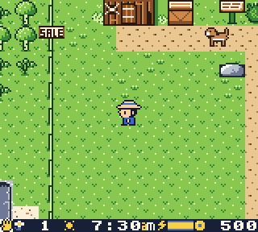
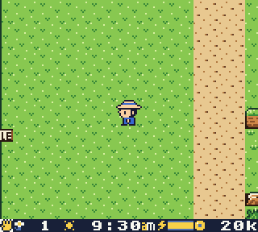

<div align="center">


### A farm that's yours to design. On a cartridge.

An original Game Boy Color world-building farm game, made for the **ModRetro Chromatic**.

<br>



<br><br>

[](../../releases/latest)
&nbsp;
[](https://modretro.com)
&nbsp;
[](#play-it)

</div>

<br>

## Grandpa left you the farm.

It's overgrown, the barn has caved in, and the shack's roof leaks. But the land is good, and there's a
whole valley of it for sale. Clear it. Plant it. Build it your way. Ride the road into town to sell
what you grow, and turn a forgotten farm into something special.

<br>

<table>
<tr>
<td width="50%" valign="top">

### Plant anything, anywhere
Fourteen crops across four seasons, plus fruit trees that last forever. Water by hand, or build
sprinklers. Fertilize for gold-star harvests, and keep watch for crows, storms and the occasional
giant pumpkin.

</td>
<td width="50%"></td>
</tr>
<tr>
<td width="50%"></td>
<td width="50%" valign="top">

### Build it your way
Barns, coops, greenhouses, silos, sheds, stables, windmills and gazebos go wherever you want them.
Lay paths, fences, hedges, fountains, flower beds and string lights. Dig ponds. Pick up anything you
built and move it.

</td>
</tr>
<tr>
<td width="50%" valign="top">

### Grow your land
Your farm sits in a 16-plot valley. Walk up to the rope line, read the sign, and buy the Pine Woods,
the Lakeside, the River Bend, the Quarry Hill or the Old Orchard. Each plot has its own land to work.

</td>
<td width="50%"></td>
</tr>
<tr>
<td width="50%"></td>
<td width="50%" valign="top">

### Take it to town
Follow the road south to a little town of shops and neighbours: seeds and animals at Rosa's General
Store, tool upgrades at Brick's Forge, houses and renovations at June's Carpentry, coffee at Ada's,
festivals at Town Hall, and land at the Land Office.

</td>
</tr>
</table>

<br>

<div align="center">

## Make it yours

Renovate your house and every farm building into one of four styles.


**Classic** · **Modern** · **Log Cabin** · **Storybook Cottage**

</div>

<br>

<div align="center">

## The people of the valley


</div>

<br>

## Everything in the box

| | |
|---|---|
| **World** | 32×32-tile scrolling farm split into 16 buyable land plots, plus a hand-built town |
| **Farming** | 14 crops, 4 fruit trees, quality stars, fertilizer, sprinklers, giant pumpkins |
| **Animals** | Cows and hens with names, happiness and visible wandering, plus a dog who follows you around |
| **Building** | 9 farm buildings, 30+ decorations, 4 fence styles, 4 path styles, ponds and bridges, move and remove |
| **Styles** | Classic, Modern, Log Cabin and Storybook Cottage, covering the house and every farm building |
| **Home** | A house interior to decorate with 11 kinds of furniture, a TV with the forecast, and a diary save |
| **Town** | 6 townsfolk with portraits, friendship, gifts, a request board and 4 seasonal festivals |
| **Crafting** | Kegs, cheese presses and preserve jars; ore from the quarry for copper, iron and gold tools |
| **Fishing** | A reel-in minigame with fish that depend on the water, season and time of day |
| **Goals** | 21 milestones with letters from Grandpa, a year-end review, a collection log |
| **Sound** | 8 original chiptune songs and 4 jingles on a custom 4-channel driver, plus sound effects |
| **Seasons** | Golden autumns, snowy winters, rain, thunderstorms, and lamps that glow at night |
| **Saves** | Two battery-backed save slots |

<br>

<div align="center">


</div>

<br>

## Play it

**On a ModRetro Chromatic (Codex Edition)**
1. Do ModRetro's one-time setup: update the firmware and enable Developer Mode.
2. Download `stilwell_farms.gbc` from the [latest release](../../releases/latest).
3. In the ChatGPT desktop app, open Codex, invoke the **ModRetro Chromatic** plugin, preview the ROM,
   and choose **Install on Chromatic**. This overwrites the cartridge's current game and saves.

**On any other Chromatic or a Game Boy Color**: write the ROM to a flash cartridge (MBC5 + RAM + battery).

**On your computer**: open the ROM in any Game Boy Color emulator, such as SameBoy or mGBA.

<br>

## Controls

| Button | On the farm | In menus |
|---|---|---|
| D-pad | Walk (tap to turn) | Move the cursor |
| **A** | Use your tool, talk, harvest, pick up | Confirm |
| **B** | Hold to run | Back |
| **SELECT** | Switch tools | |
| **START** | Menu: Tools, Seeds, Bag, Build, Farm (status, map, calendar, friends, goods), Options, Save | |

<br>

## Under the hood

Stilwell Farms is written in C with [GBDK-2020](https://github.com/gbdk-2020/gbdk-2020) and runs on
real Game Boy Color hardware.

- **Tile cache.** The Game Boy Color can only show 512 background tiles at once. The game keeps all of
  its art (over 1,300 tiles) on the cartridge and streams just the tiles on screen into video memory
  as you scroll, reference-counting each one. That's what lets one game hold hundreds of buildings,
  crops and decorations.
- **Text art pipeline.** Every tile, sprite and map is a text file in `art/`, compiled by
  `tools/gen_art.py` into banked C data. Maps (`art/maps/*.map`) are plain-text grids.
- **Music.** Songs are written in a small MML dialect (`art/music/*.mml`) and compiled by
  `tools/gen_music.py` for a custom VBlank-driven driver.
- **Headless playtesting.** `tools/play.py` drives the ROM in PyBoy from a script, with pathfinding,
  memory inspection and screenshots.

### Build from source
```sh
# needs GBDK-2020 (https://github.com/gbdk-2020/gbdk-2020/releases) and Python 3
python3 -m venv .venv && .venv/bin/pip install pillow pyboy
GBDK=/path/to/gbdk ./build.sh        # -> build/stilwell_farms.gbc
```

<br>

## On the way
Rare and legendary seeds and animal breeds · sheep and wool · animal breeding · town businesses you
can buy · farmhands on salary · barn interiors · a mine under Rocky Hollow · a beach and ocean
fishing · cooking · festival minigames.

<br>

<div align="center">

<sub>Stilwell Farms is an independent, original fan project made for the ModRetro Chromatic. It is not
affiliated with or endorsed by ModRetro, OpenAI or Nintendo. Game Boy and Game Boy Color are
trademarks of Nintendo.</sub>

<br>

`#chromatic` `#modretro` `#gameboycolor` `#homebrew` `#gbdk` `#pixelart` `#chiptune` `#farminggame`

</div>
