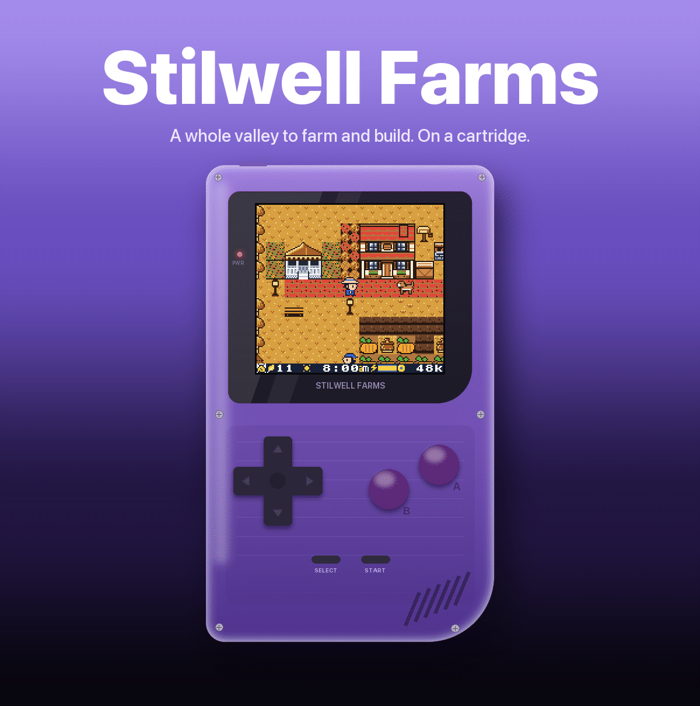
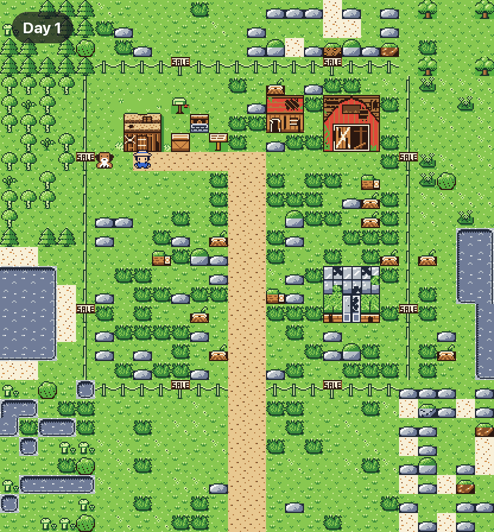
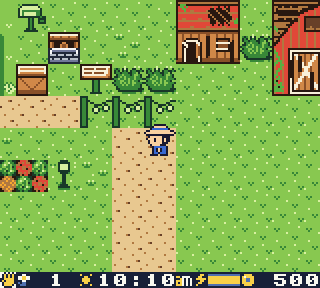
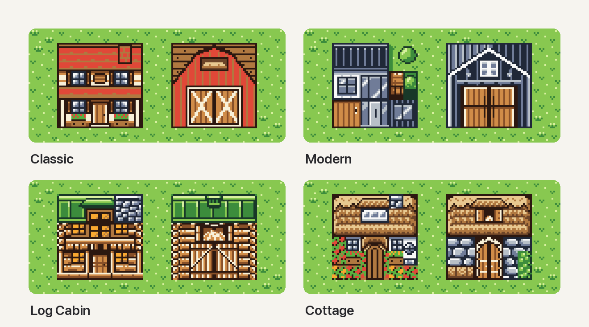
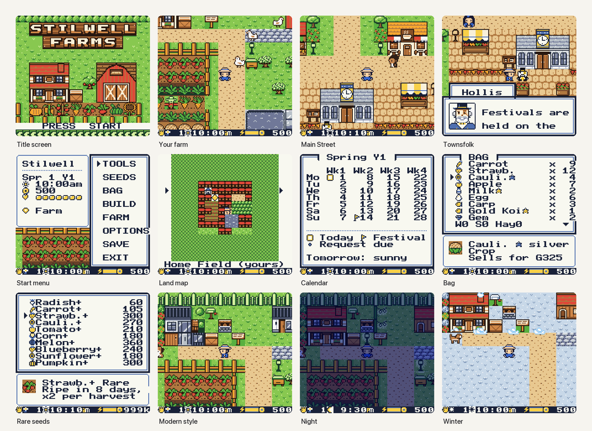
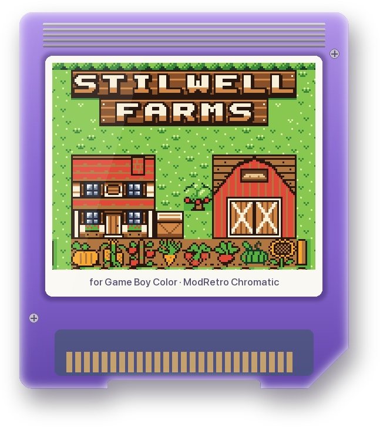

<div align="center">

<a href="#play-it"></a>

<br><br>

[](../../releases/latest)
&nbsp;
[](https://modretro.com)
&nbsp;
[](#play-it)

`#chromatic` `#modretro`

</div>

<br>

<div align="center">

## Grandpa left you the farm.

It's overgrown. The barn has caved in. The shack's roof leaks.<br>
But the land is good, and there's a whole valley of it for sale.

**Clear it. Plant it. Build it your way.**

</div>

<br>

<div align="center">

## Watch it grow.

The same farm, from the first morning to the late game.



<br><br>


</div>

<br>

<table>
<tr>
<td width="50%" valign="middle">

### Plant something legendary.
Fourteen crops across four seasons, and fruit trees that last forever. Seed packets come in
**Common**, **Rare** and **Legendary**: rare crops double the harvest, and legendary ones twinkle in
the field and come up three or four at a time, always gold star. Till, plant, water, sleep, and wake
up to sprouts.

</td>
<td width="50%"></td>
</tr>
<tr>
<td width="50%"></td>
<td width="50%" valign="middle">

### Build it your way.
Barns, coops, greenhouses, silos, sheds, stables, windmills, farm stands and gazebos go wherever
you want them. Each building previews as a ghost before you place it. Lay fences, paths, hedges, flower
beds and string lights, dig ponds, and pick anything up to move it later.

</td>
</tr>
<tr>
<td width="50%" valign="middle">

### Buy the valley.
Your farm sits in a 16-plot valley. Walk up to the rope line, read the sign, and buy the
Wildflower Hill, the Lakeside, the River Bend, the Pine Woods or the Old Orchard. The rope comes down
and the land is yours to work.

</td>
<td width="50%"></td>
</tr>
<tr>
<td width="50%"></td>
<td width="50%" valign="middle">

### Raise a golden herd.
Cows, hens and sheep, each with a name. Rare Jersey cows, brown hens and cocoa sheep give double, and
golden breeds give double gold-star milk, eggs and wool. Shear sheep right in the field. Two happy adults may have a baby
overnight, and sometimes it comes out one breed better.

</td>
</tr>
<tr>
<td width="50%" valign="middle">

### Hire some help.
Mayor Hollis knows folks in town who want work. Hire a Waterer, a Harvester, a Rancher and a
Groundskeeper. They show up on your farm by day and do their jobs overnight: watering, harvesting and
shipping, feeding the animals, pulling weeds. Wages grow with the farm, so keep some cash on hand.

</td>
<td width="50%"></td>
</tr>
<tr>
<td width="50%"></td>
<td width="50%" valign="middle">

### Open a business in town.
Follow the road south to a little town of shops and neighbours. Buy one of the boarded-up storefronts
and open a **Bakery**, a **Juice Bar**, a **Creamery** or a **Florist**. Stock the pantry with what
you grow and it sells pies, smoothies, ice cream and bouquets every night. Upgrade the kitchen
to sell more, for more.

</td>
</tr>
<tr>
<td width="50%" valign="middle">

### Make the house a home.
Buy furniture from the catalogue and arrange it however you like: rugs, armchairs, house plants,
bookshelves, tables, lamps, a fridge, a fireplace, paintings. Upgrade to the Big House and your
furniture comes with you. The TV has tomorrow's forecast, and the diary saves your game.

</td>
<td width="50%"></td>
</tr>
<tr>
<td width="50%"></td>
<td width="50%" valign="middle">

### Four seasons, and the nights between.
Spring greens, golden autumns, snowy winters, rain and thunderstorms. Evenings warm up and get dark,
and your lamps and string lights come on at 7pm.

</td>
</tr>
<tr>
<td width="50%" valign="middle">

### Go fishing.
Cast into any water, wait for the bite and reel it in. What bites depends on the water, the season
and the time of day.

</td>
<td width="50%"></td>
</tr>
</table>

<br>

<div align="center">

## Make it yours.

Renovate your house and every farm building into one of four styles.



**Classic** · **Modern** · **Log Cabin** · **Storybook Cottage**

</div>

<br>

<div align="center">

## The people of the valley.


</div>

<br>

<div align="center">

## Everything in the box.

</div>

| | |
|---|---|
| **World** | A 32×32-tile scrolling farm split into 16 buyable land plots, plus a hand-built town |
| **Farming** | 14 crops in Common, Rare and Legendary, 4 fruit trees, quality stars, fertilizer, sprinklers, giant pumpkins |
| **Animals** | Cows, hens and sheep with names and happiness, rare and golden breeds, wool, breeding, and Buddy the dog |
| **Farmhands** | Waterer, Harvester, Rancher and Groundskeeper, hired at town hall and paid nightly |
| **Businesses** | Bakery, Juice Bar, Creamery and Florist storefronts to buy, stock and upgrade |
| **Building** | 9 farm buildings, 30+ decorations, 4 fence styles, 4 path styles, ponds and bridges, move and remove |
| **Styles** | Classic, Modern, Log Cabin and Storybook Cottage, covering the house and every farm building |
| **Home** | A house interior with 11 kinds of furniture to buy and arrange, a TV forecast and a diary save |
| **Town** | 6 townsfolk with portraits, friendship, gifts, a request board and seasonal festivals |
| **Crafting** | Kegs, cheese presses and preserve jars; ore for copper, iron and gold tools |
| **Fishing** | A reel-in minigame with fish that depend on the water, season and time of day |
| **Goals** | Milestones with letters from Grandpa, a year-end review and a collection log |
| **Sound** | Original chiptune songs and jingles on a custom 4-channel driver, plus sound effects |
| **Saves** | Two battery-backed save slots, with an autosave every morning |

<br>

<div align="center">



</div>

<br>

<table>
<tr>
<td width="44%" align="center"></td>
<td width="56%" valign="middle">

## Play it.

**On a ModRetro Chromatic (Codex Edition)**
1. Do ModRetro's one-time setup: update the firmware and enable Developer Mode.
2. Download `stilwell_farms.gbc` from the [latest release](../../releases/latest).
3. In the ChatGPT desktop app, open Codex, invoke the **ModRetro Chromatic** plugin, preview the ROM,
   and choose **Install on Chromatic**. This overwrites the cartridge's current game and saves.

**On any other Chromatic or a Game Boy Color:** write the ROM to a flash cartridge
(MBC5 + RAM + battery).

**On your computer:** open the ROM in any Game Boy Color emulator, such as SameBoy or mGBA.

[](../../releases/latest)

</td>
</tr>
</table>

<br>

## Controls

| Button | On the farm | In menus |
|---|---|---|
| D-pad | Walk (tap to turn) | Move the cursor |
| **A** | Use your tool, talk, harvest, pet, shear, pick up | Confirm |
| **B** | Hold to run; leave build mode | Back |
| **SELECT** | Switch tools | |
| **START** | Menu: Tools, Seeds, Bag, Build, Farm (status, map, calendar, friends, goods, staff), Options, Save | |

The status bar shows your tool, the season and day, the weather, the clock, your energy and your gold.

<br>

## Under the hood

Stilwell Farms is written in C with [GBDK-2020](https://github.com/gbdk-2020/gbdk-2020) and runs on
real Game Boy Color hardware.

- **Tile cache.** The Game Boy Color can only show 512 background tiles at once. The game keeps all of
  its art on the cartridge and streams just the tiles on screen into video memory as you scroll,
  reference-counting each one. That's what lets one game hold hundreds of buildings, crops and decorations.
- **Text art pipeline.** Every tile, sprite and map is a text file in `art/`, compiled by
  `tools/gen_art.py` into banked C data. Maps (`art/maps/*.map`) are plain-text grids.
- **Music.** Songs are written in a small MML dialect (`art/music/*.mml`) and compiled by
  `tools/gen_music.py` for a custom VBlank-driven driver.
- **Headless playtesting.** `tools/play.py` and `tools/test_suite.py` drive the ROM in PyBoy from
  scripts, with pathfinding, memory inspection and screenshots.

### Build from source
```sh
# needs GBDK-2020 (https://github.com/gbdk-2020/gbdk-2020/releases) and Python 3
python3 -m venv .venv && .venv/bin/pip install pillow pyboy
GBDK=/path/to/gbdk ./build.sh        # -> build/stilwell_farms.gbc
```

<br>

<div align="center">


<sub>Stilwell Farms is an independent, original fan project made for the ModRetro Chromatic. It is not
affiliated with or endorsed by ModRetro, OpenAI or Nintendo. Game Boy and Game Boy Color are
trademarks of Nintendo.</sub>

<br>

`#chromatic` `#modretro` `#gameboycolor` `#homebrew` `#gbdk` `#pixelart` `#chiptune` `#farminggame`

</div>
