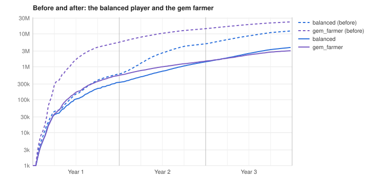
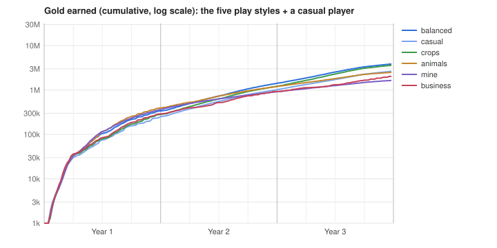
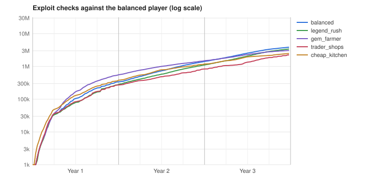

# Balance

How Stilwell Farms' economy is meant to unfold over three in-game years, the model that checks it, what was wrong
with the numbers, and every change made to fix them.

```
.venv/bin/python tools/econ_model.py                      # season tables + milestones for every strategy
.venv/bin/python tools/econ_model.py --strategy balanced --log   # one strategy's purchases, day by day
.venv/bin/python tools/econ_model.py --report --before docs/media/balance_before.json   # rewrite the tables below
.venv/bin/python tools/test_suite.py econ_year balance_rules     # the ROM against the model
```

## The arc we want

| | a normal player... |
|---|---|
| **Year 1, scrappy** | clears the home field, plants the first crops, buys hens and repairs the coop, the barn, a tool upgrade or two; the first plot of land and the first storefront come in the fall |
| **Year 2, expansion** | farmhands, plots every season, several businesses, Market Street, most of the Valley Restoration |
| **Year 3, empire** | most of the valley, all eight businesses, Town Prosperity 5, the valley finale |

No dominant strategy may trivialize it (legendary seeds + harvester, gem farming, a business that prints money,
the restaurant on cheap dishes, buying traders' goods for the shops), and nothing in the shops should be a dead
option (never worth buying).

## The model (tools/econ_model.py)

Every price, yield, growth time, cost, wage and sales formula is read from the C sources the way
`tools/test_suite.py` reads them (items.c, town.c, world.c, menus.c, farm.c, biz.c, invest.c, staff.c, valley.c,
cooking.c, areas.c, ...), so the model follows any table edit. `ECON_ROOT=<dir>` points it at another checkout:
that is how the "before" numbers below were produced (the sources at `d56f7e5`, the same model).

The quality, rarity, breeding, weather, mine and fishing dice are taken at their expected value: crop quality odds
per rarity and fertilizer, the harvester's own rolls, legendary 3-4 at a time (3 by the harvester), animal produce
by happiness and breed, the rock kinds per mine band and the rarest-gem chain, koi odds per rod tier, rain on 50
days in 256 (storms too in summer), businesses through a line-by-line port of `biz.c run_one` and `biz_overnight`,
wages through `staff.c wage_now`, prosperity through `invest.c`.

A simulated player has a day of energy (100, 130, 160 with the house upgrades; DILIGENCE 0.9) and a day of time
(840 s of real play from 6am to 2am at the default clock, 72% of it for work). Actions cost both: a can or hoe
swing 0.6 s, planting a tile 0.3 s, picking one 0.9 s, a mine rock 1.6 s, a cast 9 s, an animal 2.5 s by hand, a town
trip 70 s. Energy goes to watering first (what sprinklers and the waterer don't cover), then clearing and tilling
new land while the farm can water and seed it, then the mine and the river (more of it while a tool upgrade or a
valley project needs ore, gems or fish). Each morning the player works down the strategy's wish list and buys what
it can afford over a reserve (two nights of wages, seed money for empty soil), saving for the next big item.

One assumption shapes the curves more than any other, so it is stated plainly: a normal player keeps at most
**60 / 110 / 160 / 160 tiles planted through year 1, 220-400 in year 2 and 500-700 in year 3** (`FIELD_CAP`).
Nothing in the game stops a bigger field: sprinklers and the waterer remove the watering and the harvester the
picking, but planting and tending hundreds of tiles takes real minutes, and few players do it. The casual player
(`field_scale` 0.6) tends 60% of that.

Strategies: **balanced** (the game's suggested path), **casual** (the same plan, relaxed), **crops**, **animals**,
**mine**, **business**, and four exploit checks: **legend_rush** (legendary seeds the day they unlock, greenhouse,
harvester), **gem_farmer** (all energy in the deep mine plus Raza's feasts), **trader_shops** (buy the traders' eggs,
milk and honey to fill the Creamery, Bakery and Inn) and **cheap_kitchen** (the restaurant on cheap fish dishes).

### Validated against the ROM

`econ_year` (tools/test_suite.py) plays 112 real nights in the emulator on a mid-game farm: a 47-tile greenhouse
strawberry field with a waterer and a harvester, six Jersey cows with a rancher, a Bakery (kitchen 1, two facade
tiers, a manager, stocked with eggs, milk and pumpkins) and a Brewery on Market Street. Every night the ROM's
business takings and farmhand wages must equal the model's `run_one x biz_mult` and `wage()` exactly (they do, all
112 nights), and the year's shipping must land within 6% of the model's expected value: it comes out at **x0.995**
(G236192 shipped against G237450 expected; the shops took G672784). `balance_rules` checks the new rules in situ.

## What was wrong (the old numbers, same model)



* **Everything was over in year 2.** The balanced player owned all 64 plots by Year 2 Summer and all eight
  businesses by Year 2 Spring; the crop-focused player bought the whole valley in Year 2 Spring. A crop tile made
  about 15 gold a day and a plot of land paid for itself in under a week, so land, sprinklers and seeds compounded
  every couple of weeks.
* **Gem farming trivialized it.** The deep mine paid 78 gold a point of energy with the gold hammer (41 with the
  basic one), and Raza's 800-gold feast refilled the bar as often as you liked: the gem farmer finished the valley in
  **Year 1 Summer**.
* **Legendary seeds + greenhouse + harvester.** A legendary regrower in the greenhouse never needed replanting and
  shipped 4.6x a common tile forever; it unlocked at G20000 earned (early summer of year 1).
* **Businesses printed money.** Premium products sold for 3.5x-4x their ingredients, times up to 1.69 in bonuses:
  6.8x. The traders' goods cost 2x, so the Creamery could be filled with bought milk, eggs and honey at a profit.
  The restaurant turned a 15-gold minnow into a fish stew special worth about 1000.
* **Dead options.** Kegs (20 gold a day for 2000), golden animals (2.7x the price of a rare one for the same two
  produce once the rare one is happy), big sprinklers (dearer a tile than small ones), the fruit-tree saplings were
  the opposite: 49 gold a cell a day, passive, for 400-700.
* **The gold display stuck at 999k.** A year-3 farm holds more than a million.

## What changed, and why

| what | before | after | why |
|---|---|---|---|
| crop prices (items.c) | radish 50 ... melon 340 | x0.65 (radish 30, melon 220) | a tile now makes ~10 a day common, ~20 rare: the home field no longer pays for the valley by summer |
| seed prices | radish 20 ... melon 120 | x0.8 | keeps the early return on a seed healthy (radish 15 -> 30 in 4 days) |
| fruit | apple 60, peach 90, orange 80, cherry 70 | 45, 70, 60, 50 | follows the crops |
| fruit trees (decor.h, menus.c) | fruit every 7 days, saplings 400-700 | every 10 days, 800-1250 | a mature tree was worth 3 tiles of crops, passive; now ~1.5-2, paying back in 30-60 days |
| animal goods | milk 100, egg 50, wool 340, cheese 240 | 75, 35, 260, 180 | 12 rare animals made 2000+ a day by year-1 summer; now ~1300, paying back in 12-22 days |
| golden animals (town.c) | 12000 / 3200 / 14400 | 6500 / 1700 / 7800 | same output as rare once happy: now a small premium for gold star from day one and golden babies |
| dishes | Salad 300 ... Feast 1800 | 1.6x their ingredients' value; Feast 1.25x its three dishes (1250) | cooking still adds value but no dish is a 3x money maker; "any fish" dishes are priced on an average fish (55), not a minnow |
| legendary seeds | x8, unlock at G20000 earned | x8, unlock in year 2 or at G250000 earned | the top seeds are a year-2 reward |
| legendary regrowers (farm.c, staff.c) | stay legendary forever | settle into a rare bush after the first crop | legendary is the upgrade for one-harvest crops (2.2x a common tile), rare for regrowers (1.6-1.8x); no perpetual 4.6x tile |
| greenhouse | repair 15000, build 25000 | 25000 / 40000 | perpetual regrowers are its big payoff |
| land (world.c) | outer ring 1500-18000 (G468000) | x3: 4500-54000 (G1404000) | land is the year-2/3 sink; a plot now pays back in 11-30 days of common crops |
| business multiples (biz.c) | basic 2.5x-3x, premium 3.5x-4x; restaurant 1.5x / 2x | basic 1.5x-2x, premium 2x-2.5x; restaurant 1x-1.5x / 1.25x-1.75x | a business multiplies the farm's goods, it shouldn't multiply them by 6.8 |
| business bonuses | facade +8% a tier, prosperity +5% a level | +5%, +4% (`BIZ_PCT_*`), manager and Inn +10% | the max is now 1.45x |
| business prices | 8000 ... 60000 | 10000, 16000, 25000, 35000, 45000, 50000, 60000, 65000 | payback 15-90 days at kitchen 0, the late ones meant for years 2-3 |
| kitchens, facades | 6000 / 15000; 3000 / 6000 / 12000 | 10000 / 25000; 5000 / 10000 / 20000 | the upgrades still pay back fastest (11-58 days) |
| Market Street, lots | 25000, 8000 | 40000, 15000 | |
| community projects (invest.c) | 8000-35000 | 15000-60000 | they buy prosperity, not income |
| prosperity levels | 4 / 10 / 18 / 28 / 40 points | 4 / 12 / 22 / 34 / 48 | prosperity 5 now takes most of the facades or projects as well as all eight businesses |
| traders' goods (invest.c) | 2x | 4x (`TRADER_MULT`) | dearer than any business can sell them for: they're for recipes and the Market Pantry, not for resale |
| the mine (areas.c, items.c) | deep floors 78 g/energy (gold hammer) | 18.7 (12.4 with the basic hammer, 8-11 near the top) | fewer gem nodes and gold seams deep down, each rarer gem about a fifth as likely, ore and gems cheaper (copper 30 ... diamond 1200) |
| food (cooking.c, town.c cafe, `G.ate`) | eat as much as you can pay for | dishes and Raza's meals restore at most one more full bar a day | energy can't be bought without limit and poured into the mine |
| kegs | 2000, 5 days | 1500, 3 days | 50-55 days payback on cheap produce instead of 100 |
| preserves jars | 1500 | 1200 | ~44 days |
| big sprinkler (decor.c) | 1200 | 800 | cheaper a tile than small sprinklers (33 vs 37.5) |
| tools (town.c) | 2000 / 5000 / 12000 | 3000 / 10000 / 25000 | a gold tool lands in year-1 fall, not summer |
| valley projects (valley.c) | 1000 ... 25000 (G38500) | 1500, 3000, 4000, 10000, 8000, 60000 (G86500) | the restoration is a year-2 thread with a year-3 finale |
| HUD + shop money box (hud.c, uix.c) | 999k at most | up to 9999k (a millionaire's four figures over the coin) | year-3 gold no longer sticks at 999k |

Morning-report numbers stay in range: a business's night is capped at 65535 by `biz_overnight` and the richest
possible night (a maxed restaurant serving Feasts) is about 30000 now; the report totals are 32-bit.

## Results





The balanced player now buys the first plot and the first storefront in Year 1 Fall, the gold tool late that fall,
Market Street in Year 2, all eight businesses at the end of Year 2, Prosperity 5 and the valley finale around the
turn of year 3, and the whole valley in Year 3 Fall. The casual player is a season or two behind (Prosperity 5 and
the finale in Year 3 Spring, most of the valley by the end of year 3). The exploit checks no longer get ahead: the
legendary rush runs level with the balanced player, the restaurant on fish dishes too, buying traders' goods for
the shops loses money, and the gem farmer, still the fastest start in year 1 (a full-time miner with a feast a
day), falls back to the pack in years 2-3 because the mine doesn't scale and the farm does. The business-first
player is the slowest: shops need a farm to feed them.

<!-- econ_model:begin -->
### Income by season (after)

Gold earned during the season (per day) and what the farm holds at its end. `tiles` = planted soil, `P` = Town Prosperity, `valley` = restoration projects done.

**balanced**: a bit of everything, the way the game suggests it

| season | earned / day | earned total | plots | tiles | shops | P | valley | staff | animals |
|---|---:|---:|---:|---:|---:|---:|---:|---:|---:|
| Y1 Spring | 1231 | 34k | 4 | 60 | 0 | 0 | 0 | 0 | 3 |
| Y1 Summer | 2475 | 104k | 4 | 110 | 0 | 0 | 0 | 1 | 10 |
| Y1 Fall | 4070 | 218k | 5 | 160 | 1 | 0 | 1 | 2 | 12 |
| Y1 Winter | 4209 | 336k | 5 | 160 | 2 | 1 | 2 | 2 | 12 |
| Y2 Spring | 5347 | 485k | 6 | 220 | 3 | 1 | 3 | 2 | 12 |
| Y2 Summer | 8590 | 726k | 10 | 300 | 5 | 2 | 5 | 2 | 12 |
| Y2 Fall | 11416 | 1.05M | 14 | 400 | 8 | 3 | 5 | 2 | 12 |
| Y2 Winter | 12766 | 1.40M | 19 | 400 | 8 | 5 | 6 | 2 | 12 |
| Y3 Spring | 15795 | 1.85M | 33 | 500 | 8 | 5 | 6 | 2 | 12 |
| Y3 Summer | 23924 | 2.52M | 53 | 600 | 8 | 5 | 6 | 2 | 12 |
| Y3 Fall | 28243 | 3.31M | 64 | 700 | 8 | 5 | 6 | 2 | 12 |
| Y3 Winter | 20598 | 3.88M | 64 | 700 | 8 | 5 | 6 | 2 | 12 |

**casual**: the balanced plan at a relaxed pace: a smaller field, fewer trips to the mine and the river

| season | earned / day | earned total | plots | tiles | shops | P | valley | staff | animals |
|---|---:|---:|---:|---:|---:|---:|---:|---:|---:|
| Y1 Spring | 1059 | 30k | 4 | 36 | 0 | 0 | 0 | 0 | 3 |
| Y1 Summer | 1588 | 74k | 4 | 65 | 0 | 0 | 0 | 1 | 9 |
| Y1 Fall | 2898 | 155k | 4 | 96 | 1 | 0 | 1 | 1 | 12 |
| Y1 Winter | 3355 | 249k | 4 | 96 | 1 | 0 | 2 | 1 | 12 |
| Y2 Spring | 4286 | 369k | 5 | 132 | 2 | 1 | 3 | 2 | 12 |
| Y2 Summer | 6389 | 548k | 9 | 180 | 4 | 1 | 5 | 2 | 12 |
| Y2 Fall | 8210 | 778k | 14 | 240 | 6 | 2 | 5 | 2 | 12 |
| Y2 Winter | 8280 | 1.01M | 14 | 240 | 8 | 3 | 5 | 2 | 12 |
| Y3 Spring | 11005 | 1.32M | 16 | 300 | 8 | 5 | 6 | 2 | 12 |
| Y3 Summer | 13937 | 1.71M | 32 | 360 | 8 | 5 | 6 | 2 | 12 |
| Y3 Fall | 19577 | 2.26M | 47 | 420 | 8 | 5 | 6 | 2 | 12 |
| Y3 Winter | 14454 | 2.66M | 58 | 420 | 8 | 5 | 6 | 2 | 12 |

**crops**: fields first: sprinklers, land, seeds, field hands; shops that sell produce

| season | earned / day | earned total | plots | tiles | shops | P | valley | staff | animals |
|---|---:|---:|---:|---:|---:|---:|---:|---:|---:|
| Y1 Spring | 1184 | 33k | 4 | 60 | 0 | 0 | 0 | 0 | 2 |
| Y1 Summer | 1629 | 79k | 4 | 110 | 0 | 0 | 0 | 0 | 11 |
| Y1 Fall | 3265 | 170k | 6 | 160 | 0 | 0 | 0 | 1 | 12 |
| Y1 Winter | 3912 | 280k | 6 | 160 | 0 | 0 | 2 | 1 | 12 |
| Y2 Spring | 4784 | 414k | 7 | 220 | 2 | 1 | 3 | 1 | 12 |
| Y2 Summer | 7514 | 624k | 10 | 300 | 3 | 1 | 3 | 1 | 12 |
| Y2 Fall | 10275 | 912k | 14 | 400 | 7 | 2 | 4 | 1 | 12 |
| Y2 Winter | 10407 | 1.20M | 14 | 400 | 8 | 4 | 4 | 1 | 12 |
| Y3 Spring | 15314 | 1.63M | 29 | 500 | 8 | 5 | 4 | 1 | 12 |
| Y3 Summer | 22750 | 2.27M | 48 | 600 | 8 | 5 | 4 | 1 | 12 |
| Y3 Fall | 28486 | 3.07M | 64 | 700 | 8 | 5 | 4 | 1 | 12 |
| Y3 Winter | 20066 | 3.63M | 64 | 700 | 8 | 5 | 4 | 1 | 12 |

**animals**: barn and coop full of rare breeds, presses and jars, the Creamery and the Inn

| season | earned / day | earned total | plots | tiles | shops | P | valley | staff | animals |
|---|---:|---:|---:|---:|---:|---:|---:|---:|---:|
| Y1 Spring | 1125 | 31k | 4 | 40 | 0 | 0 | 0 | 1 | 7 |
| Y1 Summer | 2934 | 114k | 4 | 110 | 0 | 0 | 0 | 1 | 12 |
| Y1 Fall | 4975 | 253k | 5 | 160 | 2 | 1 | 1 | 2 | 12 |
| Y1 Winter | 4966 | 392k | 7 | 160 | 2 | 1 | 3 | 2 | 12 |
| Y2 Spring | 4781 | 526k | 14 | 160 | 2 | 1 | 3 | 2 | 12 |
| Y2 Summer | 7017 | 722k | 14 | 160 | 5 | 2 | 3 | 2 | 12 |
| Y2 Fall | 8156 | 951k | 14 | 160 | 8 | 3 | 3 | 2 | 12 |
| Y2 Winter | 8455 | 1.19M | 16 | 160 | 8 | 5 | 3 | 2 | 12 |
| Y3 Spring | 9879 | 1.46M | 26 | 160 | 8 | 5 | 6 | 2 | 12 |
| Y3 Summer | 11707 | 1.79M | 35 | 160 | 8 | 5 | 6 | 2 | 12 |
| Y3 Fall | 15858 | 2.24M | 50 | 160 | 8 | 5 | 6 | 2 | 12 |
| Y3 Winter | 9655 | 2.51M | 56 | 160 | 8 | 5 | 6 | 2 | 12 |

**mine**: the hammer first: deep floors, ore and gems sold at the forge

| season | earned / day | earned total | plots | tiles | shops | P | valley | staff | animals |
|---|---:|---:|---:|---:|---:|---:|---:|---:|---:|
| Y1 Spring | 1118 | 31k | 4 | 60 | 0 | 0 | 0 | 0 | 2 |
| Y1 Summer | 2946 | 114k | 4 | 110 | 0 | 0 | 0 | 0 | 11 |
| Y1 Fall | 4142 | 230k | 4 | 120 | 2 | 1 | 2 | 1 | 12 |
| Y1 Winter | 4664 | 360k | 7 | 120 | 4 | 1 | 2 | 1 | 12 |
| Y2 Spring | 4658 | 491k | 10 | 120 | 5 | 2 | 2 | 1 | 12 |
| Y2 Summer | 4889 | 628k | 14 | 120 | 6 | 2 | 2 | 1 | 12 |
| Y2 Fall | 4822 | 763k | 14 | 120 | 7 | 2 | 2 | 1 | 12 |
| Y2 Winter | 5207 | 909k | 14 | 120 | 8 | 4 | 2 | 1 | 12 |
| Y3 Spring | 5668 | 1.07M | 17 | 120 | 8 | 5 | 2 | 1 | 12 |
| Y3 Summer | 6744 | 1.26M | 27 | 120 | 8 | 5 | 3 | 1 | 12 |
| Y3 Fall | 7853 | 1.48M | 32 | 120 | 8 | 5 | 3 | 1 | 12 |
| Y3 Winter | 6198 | 1.65M | 37 | 120 | 8 | 5 | 3 | 1 | 12 |

**business**: storefronts as early as possible, Market Street, kitchens and facades; the farm feeds the shops

| season | earned / day | earned total | plots | tiles | shops | P | valley | staff | animals |
|---|---:|---:|---:|---:|---:|---:|---:|---:|---:|
| Y1 Spring | 1283 | 36k | 4 | 60 | 1 | 0 | 0 | 0 | 3 |
| Y1 Summer | 1699 | 83k | 4 | 110 | 1 | 0 | 0 | 0 | 11 |
| Y1 Fall | 3614 | 185k | 5 | 160 | 2 | 1 | 0 | 1 | 12 |
| Y1 Winter | 3705 | 288k | 5 | 160 | 2 | 1 | 1 | 1 | 12 |
| Y2 Spring | 3844 | 396k | 6 | 220 | 3 | 2 | 1 | 1 | 12 |
| Y2 Summer | 4437 | 520k | 8 | 300 | 3 | 2 | 2 | 1 | 12 |
| Y2 Fall | 7759 | 738k | 9 | 400 | 5 | 3 | 2 | 1 | 12 |
| Y2 Winter | 6741 | 926k | 10 | 400 | 5 | 3 | 2 | 1 | 12 |
| Y3 Spring | 7214 | 1.13M | 13 | 500 | 6 | 4 | 3 | 1 | 12 |
| Y3 Summer | 6607 | 1.31M | 14 | 600 | 6 | 4 | 3 | 1 | 12 |
| Y3 Fall | 12424 | 1.66M | 18 | 700 | 8 | 5 | 4 | 1 | 12 |
| Y3 Winter | 13270 | 2.03M | 18 | 700 | 8 | 5 | 4 | 1 | 12 |

**legend_rush**: EXPLOIT CHECK: legendary seeds the day they unlock, greenhouse, harvester, every coin into fields

| season | earned / day | earned total | plots | tiles | shops | P | valley | staff | animals |
|---|---:|---:|---:|---:|---:|---:|---:|---:|---:|
| Y1 Spring | 1181 | 33k | 4 | 60 | 0 | 0 | 0 | 1 | 2 |
| Y1 Summer | 1629 | 79k | 4 | 110 | 0 | 0 | 0 | 1 | 10 |
| Y1 Fall | 3073 | 165k | 6 | 160 | 0 | 0 | 0 | 1 | 12 |
| Y1 Winter | 4144 | 281k | 6 | 160 | 0 | 0 | 1 | 1 | 12 |
| Y2 Spring | 4430 | 405k | 7 | 220 | 3 | 1 | 2 | 1 | 12 |
| Y2 Summer | 5836 | 568k | 9 | 300 | 4 | 1 | 2 | 1 | 12 |
| Y2 Fall | 9041 | 821k | 14 | 400 | 6 | 2 | 3 | 1 | 12 |
| Y2 Winter | 10018 | 1.10M | 14 | 400 | 8 | 4 | 3 | 1 | 12 |
| Y3 Spring | 13180 | 1.47M | 28 | 500 | 8 | 5 | 4 | 1 | 12 |
| Y3 Summer | 20469 | 2.04M | 41 | 600 | 8 | 5 | 4 | 1 | 12 |
| Y3 Fall | 28192 | 2.83M | 62 | 700 | 8 | 5 | 4 | 1 | 12 |
| Y3 Winter | 21102 | 3.42M | 64 | 700 | 8 | 5 | 4 | 1 | 12 |

**gem_farmer**: EXPLOIT CHECK: every point of energy in the deep mine, plus a cafe feast a day to keep swinging

| season | earned / day | earned total | plots | tiles | shops | P | valley | staff | animals |
|---|---:|---:|---:|---:|---:|---:|---:|---:|---:|
| Y1 Spring | 1258 | 35k | 4 | 60 | 0 | 0 | 0 | 0 | 2 |
| Y1 Summer | 4527 | 162k | 4 | 60 | 2 | 1 | 2 | 0 | 12 |
| Y1 Fall | 6785 | 352k | 9 | 60 | 4 | 1 | 2 | 0 | 12 |
| Y1 Winter | 7080 | 550k | 11 | 60 | 6 | 2 | 3 | 0 | 12 |
| Y2 Spring | 7581 | 762k | 14 | 60 | 7 | 2 | 3 | 0 | 12 |
| Y2 Summer | 8266 | 994k | 14 | 60 | 8 | 4 | 3 | 0 | 12 |
| Y2 Fall | 8426 | 1.23M | 24 | 60 | 8 | 5 | 4 | 0 | 12 |
| Y2 Winter | 8893 | 1.48M | 29 | 60 | 8 | 5 | 4 | 0 | 12 |
| Y3 Spring | 11543 | 1.80M | 36 | 60 | 8 | 5 | 4 | 0 | 12 |
| Y3 Summer | 17468 | 2.29M | 52 | 60 | 8 | 5 | 4 | 0 | 12 |
| Y3 Fall | 17535 | 2.78M | 63 | 60 | 8 | 5 | 4 | 0 | 12 |
| Y3 Winter | 10974 | 3.09M | 64 | 60 | 8 | 5 | 4 | 0 | 12 |

**trader_shops**: EXPLOIT CHECK: once prosperity 2 brings traders, buy their eggs/milk/honey to fill the Creamery, Bakery and Inn

| season | earned / day | earned total | plots | tiles | shops | P | valley | staff | animals |
|---|---:|---:|---:|---:|---:|---:|---:|---:|---:|
| Y1 Spring | 1269 | 36k | 4 | 60 | 1 | 0 | 0 | 0 | 3 |
| Y1 Summer | 1691 | 83k | 4 | 110 | 2 | 1 | 0 | 0 | 11 |
| Y1 Fall | 3151 | 171k | 4 | 160 | 2 | 1 | 0 | 1 | 12 |
| Y1 Winter | 3537 | 270k | 4 | 160 | 2 | 1 | 1 | 1 | 12 |
| Y2 Spring | 3498 | 368k | 4 | 173 | 2 | 1 | 1 | 1 | 12 |
| Y2 Summer | 4113 | 483k | 5 | 227 | 2 | 2 | 2 | 1 | 12 |
| Y2 Fall | 5414 | 635k | 9 | 400 | 2 | 2 | 2 | 1 | 12 |
| Y2 Winter | 7051 | 832k | 12 | 400 | 2 | 2 | 3 | 1 | 12 |
| Y3 Spring | 8174 | 1.06M | 14 | 500 | 2 | 2 | 3 | 2 | 12 |
| Y3 Summer | 9983 | 1.34M | 14 | 600 | 2 | 2 | 3 | 2 | 12 |
| Y3 Fall | 18522 | 1.86M | 14 | 700 | 4 | 3 | 3 | 2 | 12 |
| Y3 Winter | 14205 | 2.26M | 15 | 700 | 5 | 3 | 3 | 2 | 12 |

**cheap_kitchen**: EXPLOIT CHECK: a fishing rod and the Restaurant: cheap fish dishes served as chef specials

| season | earned / day | earned total | plots | tiles | shops | P | valley | staff | animals |
|---|---:|---:|---:|---:|---:|---:|---:|---:|---:|
| Y1 Spring | 1694 | 47k | 4 | 60 | 1 | 0 | 0 | 0 | 4 |
| Y1 Summer | 2850 | 127k | 4 | 110 | 2 | 1 | 1 | 0 | 11 |
| Y1 Fall | 4320 | 248k | 7 | 160 | 2 | 1 | 2 | 0 | 12 |
| Y1 Winter | 4650 | 378k | 14 | 160 | 2 | 1 | 3 | 0 | 12 |
| Y2 Spring | 5794 | 541k | 14 | 220 | 3 | 2 | 3 | 0 | 12 |
| Y2 Summer | 8789 | 787k | 14 | 300 | 7 | 3 | 3 | 0 | 12 |
| Y2 Fall | 6344 | 964k | 14 | 400 | 8 | 4 | 3 | 0 | 12 |
| Y2 Winter | 7879 | 1.18M | 14 | 400 | 8 | 4 | 3 | 0 | 12 |
| Y3 Spring | 10769 | 1.49M | 14 | 500 | 8 | 5 | 3 | 0 | 12 |
| Y3 Summer | 16522 | 1.95M | 20 | 599 | 8 | 5 | 3 | 0 | 12 |
| Y3 Fall | 7513 | 2.16M | 29 | 700 | 8 | 5 | 4 | 0 | 12 |
| Y3 Winter | 11879 | 2.49M | 36 | 700 | 8 | 5 | 4 | 0 | 12 |

### Milestones: when each strategy reaches them (before -> after)

| strategy | first plot bought | a tool at copper | first storefront | a gold tool | 10 plots | Market Street business | half the valley (32 plots) | all 8 businesses | prosperity 5 | valley finale | every plot (64) |
|---|---|---|---|---|---|---|---|---|---|---|---|
| balanced | Y1 Sp 25 -> **Y1 Fa 17** | Y1 Sp 18 -> **Y1 Sp 21** | Y1 Su 21 -> **Y1 Fa 20** | Y1 Su 14 -> **Y1 Fa 14** | Y1 Fa 14 -> **Y2 Su 23** | Y1 Wi 1 -> **Y2 Su 23** | Y2 Sp 6 -> **Y3 Sp 23** | Y2 Sp 12 -> **Y2 Fa 27** | Y2 Sp 15 -> **Y2 Wi 17** | - -> **Y2 Wi 22** | Y2 Su 4 -> **Y3 Fa 20** |
| casual | Y1 Sp 28 -> **Y2 Sp 3** | Y1 Sp 17 -> **Y1 Sp 20** | Y1 Su 22 -> **Y1 Fa 28** | Y1 Su 13 -> **Y1 Fa 24** | Y1 Fa 16 -> **Y2 Fa 12** | Y1 Wi 9 -> **Y2 Fa 10** | Y2 Sp 15 -> **Y3 Su 27** | Y2 Sp 21 -> **Y2 Wi 22** | Y2 Sp 24 -> **Y3 Sp 18** | - -> **Y3 Sp 25** | Y2 Su 14 -> **-** |
| crops | Y1 Sp 22 -> **Y1 Fa 23** | Y1 Sp 15 -> **Y1 Sp 20** | Y1 Su 26 -> **Y2 Sp 15** | Y1 Su 12 -> **Y1 Fa 20** | Y1 Fa 4 -> **Y2 Su 21** | Y1 Fa 21 -> **Y2 Fa 10** | Y1 Wi 9 -> **Y3 Su 5** | Y1 Wi 18 -> **Y2 Wi 9** | Y1 Wi 23 -> **Y3 Sp 5** | - -> **-** | Y2 Sp 15 -> **Y3 Fa 24** |
| animals | Y1 Su 19 -> **Y1 Fa 17** | Y1 Su 18 -> **Y1 Su 24** | Y1 Su 25 -> **Y1 Fa 17** | Y1 Su 20 -> **Y1 Fa 11** | Y1 Fa 1 -> **Y2 Sp 11** | Y1 Wi 3 -> **Y2 Su 26** | Y1 Fa 22 -> **Y3 Su 15** | Y1 Wi 10 -> **Y2 Fa 25** | Y1 Wi 14 -> **Y2 Wi 23** | - -> **Y3 Sp 26** | Y2 Sp 10 -> **-** |
| mine | Y1 Sp 22 -> **Y1 Wi 1** | Y1 Sp 16 -> **Y1 Sp 19** | Y1 Su 5 -> **Y1 Fa 14** | Y1 Sp 24 -> **Y1 Su 21** | Y1 Su 12 -> **Y2 Sp 21** | Y1 Su 23 -> **Y2 Sp 19** | Y1 Fa 7 -> **Y3 Fa 27** | Y1 Fa 13 -> **Y2 Wi 4** | Y1 Fa 14 -> **Y3 Sp 19** | - -> **-** | Y1 Wi 1 -> **-** |
| business | Y1 Sp 28 -> **Y1 Fa 24** | Y1 Sp 23 -> **Y1 Sp 28** | Y1 Sp 22 -> **Y1 Sp 27** | Y1 Su 13 -> **Y1 Fa 17** | Y1 Fa 18 -> **Y2 Wi 22** | Y1 Wi 27 -> **Y2 Fa 27** | Y2 Su 24 -> **-** | Y2 Su 28 -> **Y3 Fa 26** | Y2 Su 21 -> **Y3 Fa 27** | - -> **-** | Y2 Fa 22 -> **-** |
| legend_rush | Y1 Sp 22 -> **Y1 Fa 20** | Y1 Sp 15 -> **Y1 Sp 20** | Y1 Fa 15 -> **Y2 Sp 13** | Y1 Sp 25 -> **Y1 Fa 16** | Y1 Fa 24 -> **Y2 Fa 2** | Y1 Wi 14 -> **Y2 Fa 8** | Y2 Sp 14 -> **Y3 Su 9** | Y2 Sp 20 -> **Y2 Wi 14** | Y2 Sp 22 -> **Y3 Sp 10** | - -> **-** | Y2 Su 12 -> **Y3 Wi 3** |
| gem_farmer | Y1 Sp 19 -> **Y1 Fa 6** | Y1 Sp 15 -> **Y1 Sp 18** | Y1 Sp 23 -> **Y1 Su 21** | Y1 Sp 21 -> **Y1 Su 14** | Y1 Sp 27 -> **Y1 Wi 8** | Y1 Su 2 -> **Y1 Wi 6** | Y1 Su 11 -> **Y3 Sp 7** | Y1 Su 12 -> **Y2 Su 5** | Y1 Su 15 -> **Y2 Fa 8** | - -> **-** | Y1 Su 24 -> **Y3 Wi 7** |
| trader_shops | Y1 Sp 28 -> **Y2 Su 18** | Y1 Sp 23 -> **Y1 Sp 27** | Y1 Sp 22 -> **Y1 Sp 25** | Y1 Su 24 -> **Y1 Fa 24** | Y1 Fa 6 -> **Y2 Wi 19** | Y1 Wi 5 -> **Y3 Wi 7** | Y1 Fa 23 -> **-** | Y1 Wi 18 -> **-** | Y1 Wi 15 -> **-** | - -> **-** | Y2 Sp 7 -> **-** |
| cheap_kitchen | Y1 Sp 28 -> **Y1 Fa 10** | Y1 Sp 19 -> **Y1 Sp 24** | Y1 Sp 19 -> **Y1 Sp 23** | Y1 Su 11 -> **Y1 Su 19** | Y1 Su 16 -> **Y1 Wi 11** | Y1 Fa 21 -> **Y2 Su 17** | Y1 Wi 8 -> **Y3 Wi 12** | Y1 Wi 22 -> **Y2 Fa 18** | Y2 Sp 1 -> **Y3 Sp 13** | - -> **-** | Y2 Su 1 -> **-** |

### Gold earned by the end of each year (before -> after)

| strategy | year 1 | year 2 | year 3 |
|---|---:|---:|---:|
| balanced | 600k -> **336k** | 4.94M -> **1.40M** | 12.30M -> **3.88M** |
| casual | 462k -> **249k** | 3.59M -> **1.01M** | 8.88M -> **2.66M** |
| crops | 834k -> **280k** | 5.94M -> **1.20M** | 13.69M -> **3.63M** |
| animals | 1.01M -> **392k** | 5.15M -> **1.19M** | 9.31M -> **2.51M** |
| mine | 1.70M -> **360k** | 5.89M -> **909k** | 10.04M -> **1.65M** |
| business | 504k -> **288k** | 2.32M -> **926k** | 7.84M -> **2.03M** |
| legend_rush | 469k -> **281k** | 3.96M -> **1.10M** | 10.46M -> **3.42M** |
| gem_farmer | 5.48M -> **550k** | 14.31M -> **1.48M** | 23.13M -> **3.09M** |
| trader_shops | 1.82M -> **270k** | 12.95M -> **832k** | 26.84M -> **2.26M** |
| cheap_kitchen | 757k -> **378k** | 6.44M -> **1.18M** | 11.33M -> **2.49M** |

### Payback of each investment (after)

Cost (gold, wood/stone at Andy's prices) over the extra gold a day it brings in the situation a player first meets it (stated in the row). Town projects pay back in prosperity (+4% business takings a level, traders, the town changing), not directly.

| investment | cost | gain / day | payback (days) |
|---|---:|---:|---:|
| plot 43 (South Pasture), sprinklered, common crops | 6540 | 594 | 11 |
| plot 19 (North Meadow), sprinklered, common crops | 10540 | 594 | 18 |
| plot 29 (Wildflower Hill), sprinklered, common crops | 11418 | 559 | 20 |
| plot 21 (Old Orchard), sprinklered, common crops | 22753 | 848 | 27 |
| plot 54 (Stone Barrens), sprinklered, common crops | 46346 | 392 | 118 |
| common cow | 1500 | 92 | 16 |
| rare cow | 4500 | 205 | 22 |
| golden cow | 6500 | 205 | 32 |
| common hen | 400 | 32 | 12 |
| rare hen | 1200 | 85 | 14 |
| golden hen | 1700 | 85 | 20 |
| common sheep | 1800 | 110 | 16 |
| rare sheep | 5400 | 240 | 22 |
| golden sheep | 7800 | 240 | 32 |
| cheese press (milk -> cheese) | 1500 | 68 | 22 |
| keg (Apple -> cider) | 1500 | 28 | 53 |
| keg (Radish -> juice) | 1500 | 27 | 56 |
| preserves jar (Apple -> jam) | 1200 | 28 | 44 |
| apple tree (mature, year average) | 800 | 19 | 42 |
| peach tree (mature, year average) | 950 | 30 | 32 |
| orange tree (mature, year average) | 1100 | 26 | 43 |
| cherry tree (mature, year average) | 1250 | 21 | 59 |
| sprinkler (8 tiles, basic can) | 375 | 96 | 4 |
| big sprinkler (24 tiles, basic can) | 950 | 288 | 3 |
| fertilizer (one tile, kept for good) | 50 | 1 | 52 |
| greenhouse repair (100 regrowing tiles carried through a season change) | 25000 | 375 | 67 |
| Bakery (kitchen 0, 6 units a night) | 10000 | 659 | 15 |
| Juice Bar (kitchen 0, 6 units a night) | 16000 | 859 | 19 |
| Creamery (kitchen 0, 6 units a night) | 25000 | 562 | 45 |
| Florist (kitchen 0, 6 units a night) | 35000 | 470 | 74 |
| Brewery (kitchen 0, 6 units a night) | 60000 | 761 | 79 |
| Winery (kitchen 0, 6 units a night) | 65000 | 502 | 129 |
| Restaurant (kitchen 0, 6 units a night) | 75000 | 414 | 181 |
| Inn (kitchen 0, 6 units a night) | 80000 | 874 | 92 |
| kitchen 1 (Bakery pies) | 10000 | 915 | 11 |
| kitchen 2 (Bakery pies) | 25000 | 1525 | 16 |
| facade tier 1 (Bakery, kitchen 1) | 5000 | 347 | 14 |
| facade tier 2 (Bakery, kitchen 1) | 10000 | 347 | 29 |
| facade tier 3 (Bakery, kitchen 1) | 20000 | 347 | 58 |
| manager (Bakery, kitchen 1) | 0 | - | - |
| Market Street (unlocks the lots, +2 prosperity points) | 40000 | - | - |
| community project 0 (+4 prosperity points) | 21200 | - | - |
| community project 1 (+4 prosperity points) | 15400 | - | - |
| community project 2 (+4 prosperity points) | 31000 | - | - |
| community project 3 (+4 prosperity points) | 41050 | - | - |
| community project 4 (+4 prosperity points) | 35700 | - | - |
| community project 5 (+4 prosperity points) | 62000 | - | - |
| valley project 0 (gold + G860 of goods) | 2360 | - | - |
| valley project 1 (gold + G675 of goods) | 3675 | - | - |
| valley project 2 (gold + G1015 of goods) | 5015 | - | - |
| valley project 3 (gold + G1720 of goods) | 11720 | - | - |
| valley project 4 (gold + G1810 of goods) | 9810 | - | - |
| valley project 5 (gold + G3430 of goods) | 63430 | - | - |
| tool tier 1 | 3150 | - | - |
| tool tier 2 | 10300 | - | - |
| tool tier 3 | 25750 | - | - |

### Gold per point of energy (after, before in brackets)

| activity | gold / energy |
|---|---:|
| mine floor 1, hammer tier 0 | 8.1 (12.9) |
| mine floor 5, hammer tier 0 | 8.5 (13.8) |
| mine floor 10, hammer tier 0 | 11.4 (21.9) |
| mine floor 15, hammer tier 0 | 12.1 (32.4) |
| mine floor 20, hammer tier 0 | 12.4 (41.5) |
| mine floor 1, hammer tier 1 | 10.3 (16.5) |
| mine floor 5, hammer tier 1 | 10.8 (17.6) |
| mine floor 10, hammer tier 1 | 14.8 (28.6) |
| mine floor 15, hammer tier 1 | 15.6 (42.0) |
| mine floor 20, hammer tier 1 | 16.0 (53.7) |
| mine floor 1, hammer tier 2 | 10.9 (17.5) |
| mine floor 5, hammer tier 2 | 11.4 (18.7) |
| mine floor 10, hammer tier 2 | 17.0 (33.6) |
| mine floor 15, hammer tier 2 | 18.0 (52.2) |
| mine floor 20, hammer tier 2 | 18.3 (68.1) |
| mine floor 1, hammer tier 3 | 10.9 (17.5) |
| mine floor 5, hammer tier 3 | 11.4 (18.7) |
| mine floor 10, hammer tier 3 | 17.2 (34.7) |
| mine floor 15, hammer tier 3 | 18.3 (57.5) |
| mine floor 20, hammer tier 3 | 18.7 (78.2) |
| fishing (lake by day), rod tier 0 | 12.8 (12.8) |
| fishing (lake by day), rod tier 1 | 14.0 (14.0) |
| fishing (lake by day), rod tier 2 | 15.3 (15.3) |
| fishing (lake by day), rod tier 3 | 16.6 (16.6) |
| hand-watered melon (common), can tier 0 | 12.9 (22.1) |
| hand-watered melon (common), can tier 1 | 38.6 (66.4) |
| hand-watered melon (common), can tier 2 | 64.3 (110.6) |
| hand-watered melon (common), can tier 3 | 115.7 (199.1) |

<!-- econ_model:end -->

## Limits of the model

* Expected values, not dice: a real year has good and bad weeks (the ROM's year in `econ_year` landed at x0.995).
* The field size of a "normal player" (`FIELD_CAP`) is an assumption; a player who tends 1500 tiles will go much
  faster, as in any farming game.
* Spending on decor, furniture, styles and the horse isn't modelled (it only delays the milestones), nor festival
  prizes, request-board rewards, gifts from friends or Grandpa's letters (a few thousand gold a year).
* The valley projects' goods are modelled roughly (a few tiles of the garden's crops, fishing and mining while a
  project needs them); strategies that never fish or mine deep don't finish the restoration in the model.

## After the valley is restored (year 3 on)

The model's balanced player finishes every letter, the fountain and prosperity 5 by Year 2 Winter, and until
this pass nothing in the game read the year: year 3 was year 2 with more gold and nothing to spend it on
(G757k unspent by Y3 Winter). Three things now grow with the year (`src/lategame.c`, `src/goals.c`):

| | Rule | Numbers |
|---|---|---|
| Town Fund | Joe's INVEST board, at prosperity 5. Give gold toward the next level; it never runs out. | Level n+1 costs G100,000 + 50,000 x n. Each level adds 2 % to business takings and contract pay, up to 25 levels (+50 %); later levels still count in the review. |
| Contracts | From year 2 the request board posts three bulk orders a season: a field crop, a farm good, something caught or dug. Deliver in parts; unfinished orders lapse with the season. | Tier t = (year - 2) + stars / 2, at most 8. Sizes 30 + 15t crop (winter 12 + 6t), 10 + 5t good, 6 + 3t wild. Pay 3 x the goods' price (x fund bonus). All three: a star and G5,000 x (t + 1). |
| Yearly review | Grandpa writes every Spring 1, not only in year 2, and compares with last spring. | Score also counts 5 a fund level and 3 a star. Gift G score x 20 x (year - 1), the multiplier capped at 5. |

Festival prizes are multiplied by the year (at most 5). The animal list is 36 long (was 12): six full barns or
coops. None of this is in `tools/econ_model.py` yet.

## Places to visit, and reasons to (Nov 2026)

The day used to be cave, farm, beach, town, bed. Five more places, none of them farmable (`src/areas.c`):

| Place | Way there | Daily |
|---|---|---|
| Old Woods | east end of Main Street | 7 forage spots (berries / herb / mushroom by season), the lily pond (koi `r < 24 + 8 x tier`, catfish after 6pm), the hollow log |
| Granite Quarry | minecart at the mine entrance | 6 ore seams + 1 gem seam, hammer and 3 energy each |
| High Pasture | minecart | 6 herb spots; 3 days of hay in the trough brings home a Highland animal (breed 3: double produce) |
| Crossroads Market | minecart; open the 6th and 7th day of each week | any-season common seeds at 2x, 20 hay G300, 10 fertilizer G400, Highland cow 7000 / hen 1800 / sheep 8000 |
| Shell Island | rowing boat at the end of the pier | 7 shell spots, ocean fish at rod tier + 3, the umbrella dig |

Also: the Library's collection (`museum.c`: G1,500 an item for each finished group, G50,000 for all 70), a daily
surprise (`daily.c`: trader 2 in 8, hot crop 2 in 8, bottle 1, fish run 1, nothing 2), letters and yearly wishes
(`friends2.c`), a fifth heart scene (`hearts5.c`: 5 legendary seeds + G5,000). None of it is in the model yet.
